# Лабораторная работа № 2
## Сегментация изображений с помощью U-Net

### Цель

Реализовать U-Net и исследовать сегментацию на учебном наборе CARLA. Повторить подготовку данных, обучение и проверку модели на другом наборе — Penn-Fudan для выделения людей.

### Данные

- **CARLA:** 1060 изображений и масок для 23 классов. Разбиение: 848 для обучения, 106 для валидации и 106 для тестирования. [Источник изображений и масок](https://github.com/Rhythm-Adhikari1/U-Net/tree/072afa362ab567ceb8c151b18b00e05ac632bf26/data). Близкие номера кадров объединены в группы.
- **Penn-Fudan:** 170 фотографий людей с размеченными масками. В исходной маске каждому человеку соответствует свой номер; для семантической сегментации все ненулевые номера объединены в класс «человек», 0 — фон. Случайное разбиение с seed=42: 136 изображений для обучения, 17 для валидации и 17 для теста. [Источник набора](https://github.com/swallan/PennFudanPed/tree/ec1d4583fb436b14e2062587c8b28a5018668a5e). Авторы набора: Liming Wang, Jianbo Shi, Gang Song, I-fan Shen, *Object Detection Combining Recognition and Segmentation*, ACCV 2007.

Изображения и маски хранятся по отдельным папкам `images/train`, `images/val`, `images/test` и `masks/train`, `masks/val`, `masks/test`. OpenCV изменяет размер изображения до 96×128, переводит его в RGB и нормализует пиксели. Маски изменяют размер методом nearest neighbor, чтобы сохранить номера классов.

### Модель

Использована U-Net: пять блоков encoder, четыре блока decoder и skip connections. Функция потерь — sparse categorical crossentropy по logits, оптимизатор — Adam, batch size — 8. Базовые модели обучались с 8 начальными фильтрами. Для CARLA также сохранён дополнительный эксперимент с 32 начальными фильтрами.

### CARLA

Обучение выполнено в течение 40 эпох; выбрана эпоха 18 по validation loss. На 106 тестовых изображениях accuracy составила **0.883**, mean IoU — **0.260**. Baseline, всегда предсказывающий самый частый обучающий класс, дал mean IoU 0.021. Крупные области дороги и неба выделяются лучше редких небольших объектов.

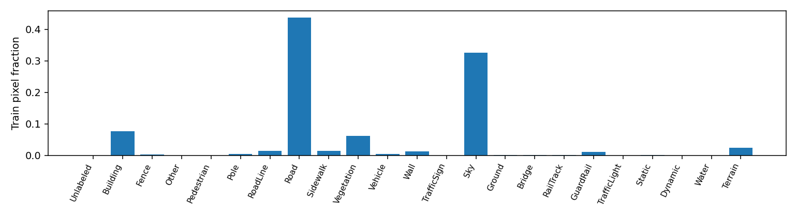

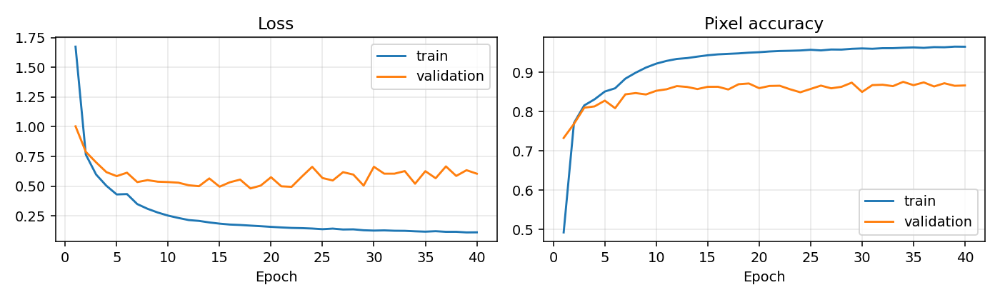

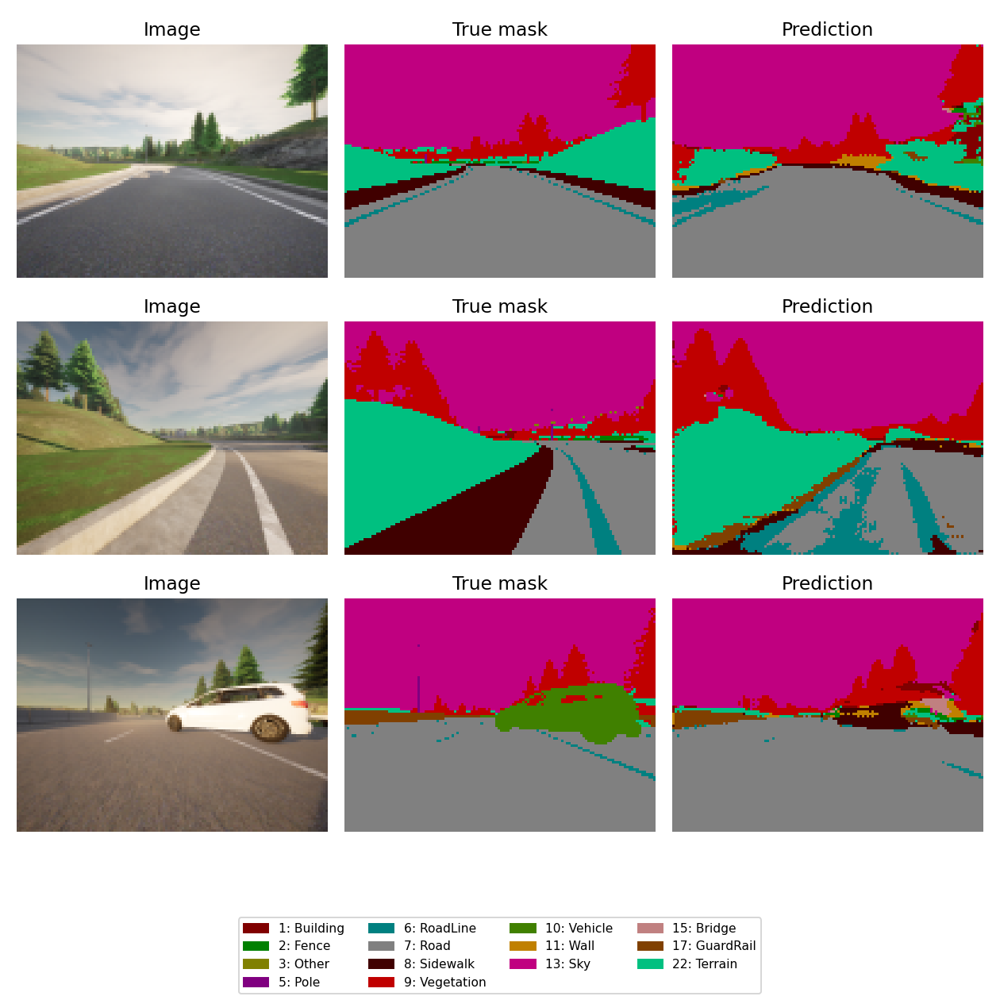

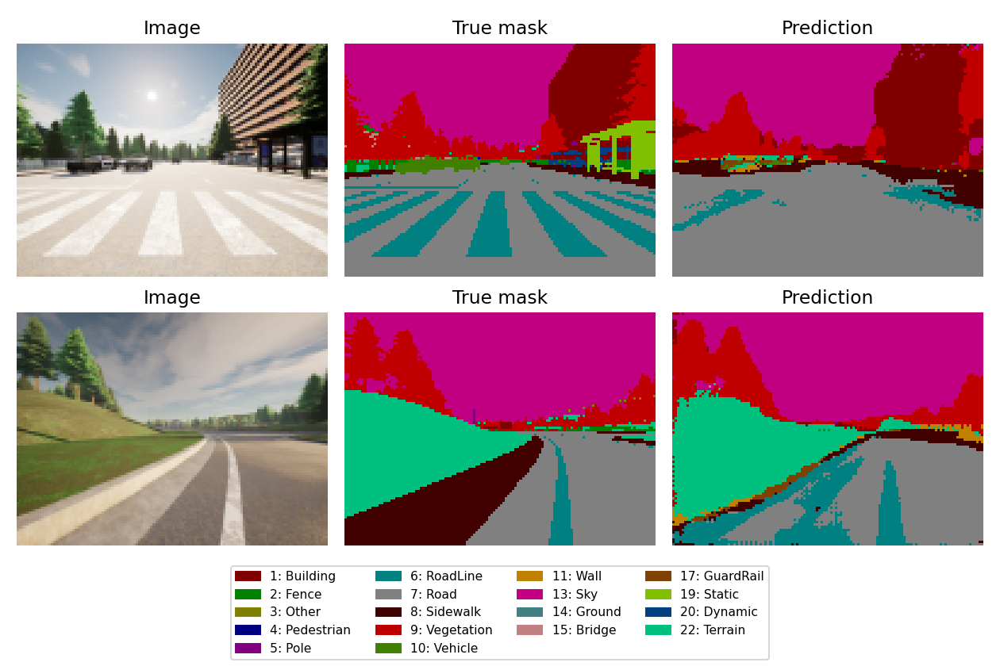

### Penn-Fudan: выделение людей

Для набора людей модель обучалась 20 эпох. По минимальному validation loss выбрана эпоха 18. На 17 тестовых изображениях получены:

| Метрика | Значение |
| --- | ---: |
| Pixel accuracy | 0.897 |
| Mean IoU по двум классам | 0.693 |
| IoU фона | 0.885 |
| IoU человека | 0.500 |
| Mean IoU baseline «всегда фон» | 0.418 |

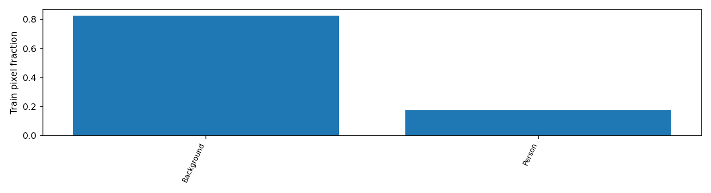

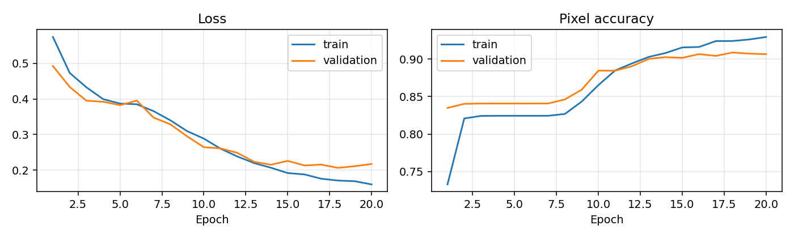

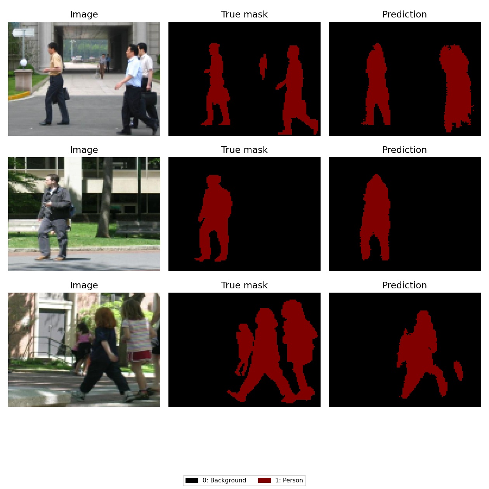

Модель выделяет заметные фигуры, но может пропустить части человека или объединить соседние фигуры. Тест содержит 17 изображений, поэтому результат даёт лишь приблизительную оценку. Метрики CARLA и Penn-Fudan нельзя напрямую сравнивать: наборы и классы различаются.

### Дополнительный эксперимент CARLA

В модели с 32 начальными фильтрами использована взвешенная функция потерь; выбор эпохи проводился по validation IoU. На тестовой части CARLA получены accuracy 0.886 и mean IoU 0.247. Одновременно менялись ширина модели и функция потерь, поэтому их отдельный вклад не определён. Поскольку тест модели с 8 фильтрами уже анализировался, сравнение имеет исследовательский характер.

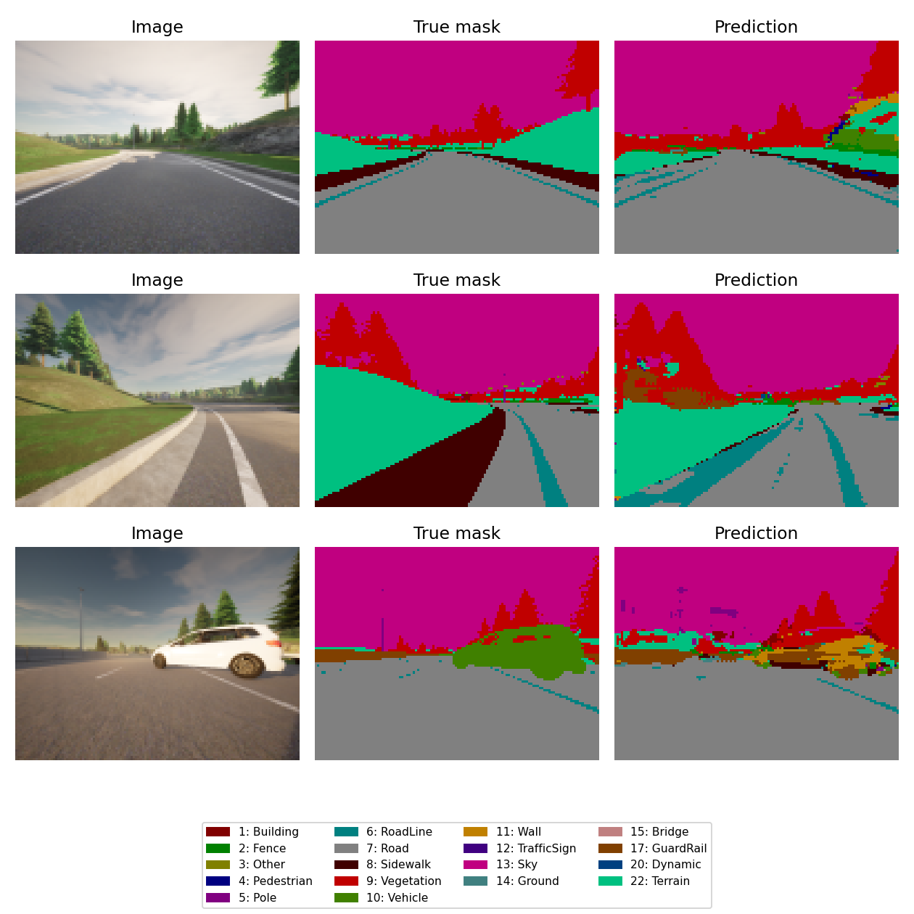

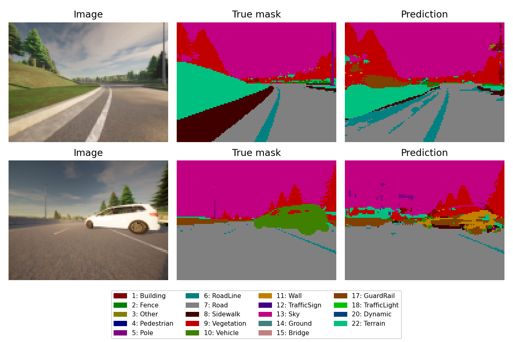

Дополнительно использованы 223 кадра из [другого набора CARLA](https://github.com/cpow-89/carla_image_segmentation_dataset/tree/aa0eb00150f3fda6f7950f097baa145890717979). В нём оцениваются классы 1–12, а неразмеченные пиксели исключены. Mean IoU составил 0.146 для модели с 8 фильтрами и 0.247 для модели с 32 фильтрами. Эти значения относятся к другой схеме оценки.

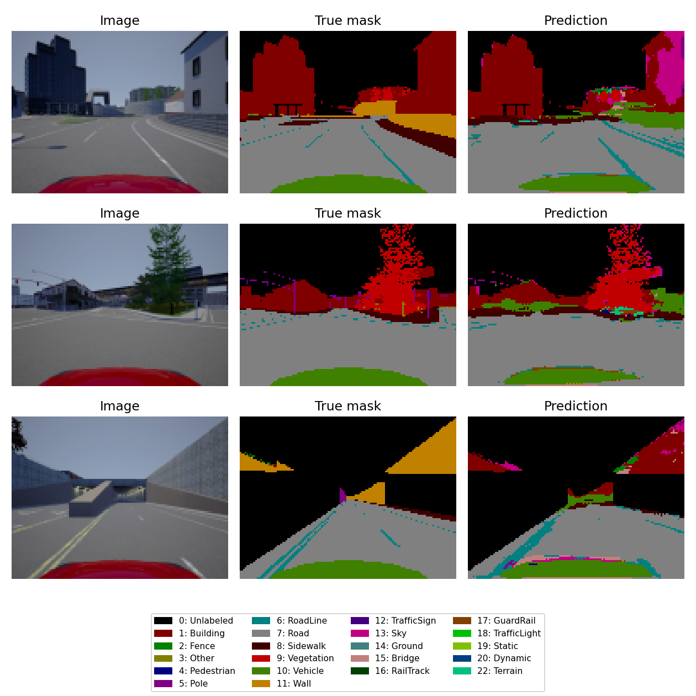

### Вывод

U-Net обучена на двух задачах: многоклассовой сегментации CARLA и выделении людей из фона. Результаты на тестовых масках подтверждают работу модели, но также показывают ошибки на небольших объектах и границах.

### Собственные фотографии

Обученные модели дополнительно применены к четырём собственным фотографиям. Для этих изображений эталонных масок нет, поэтому IoU не рассчитывался. Модель людей ошибочно выделяет части фона на некоторых снимках; это видно на предсказанных масках.

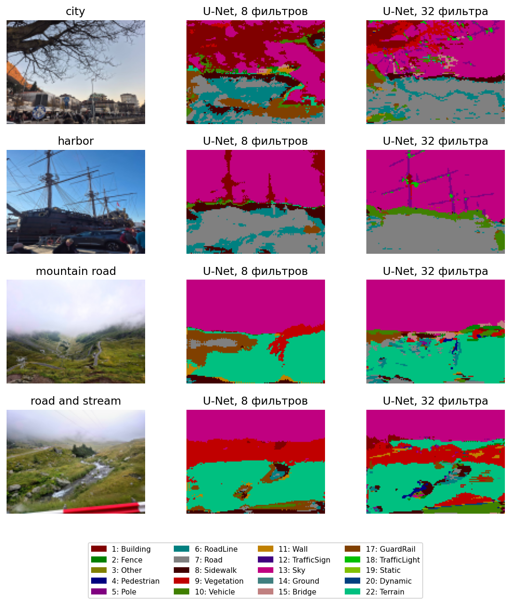

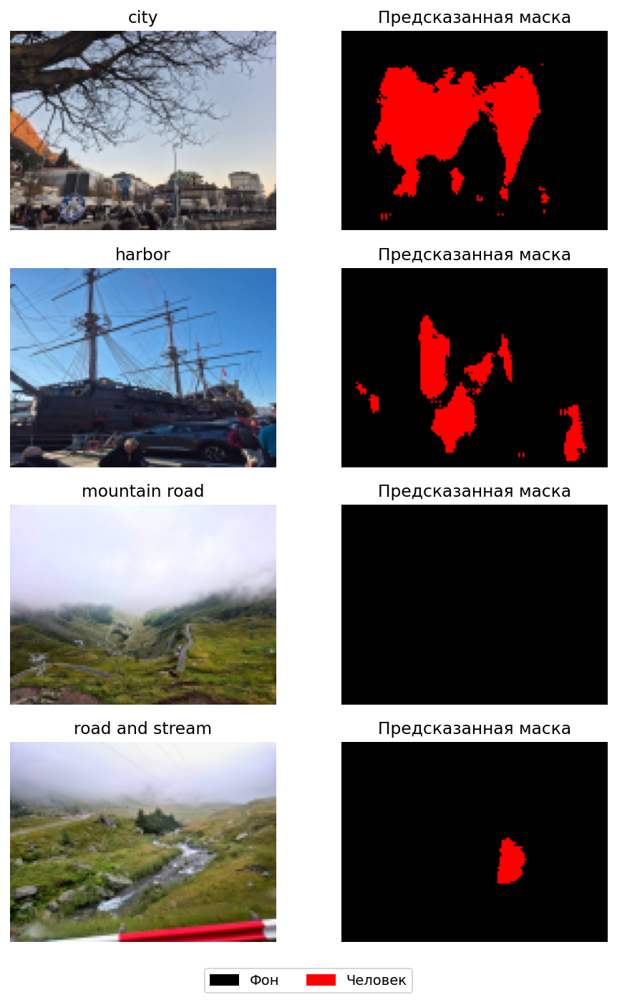
