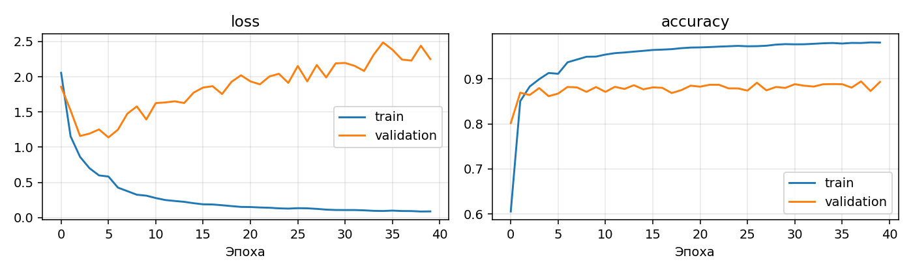
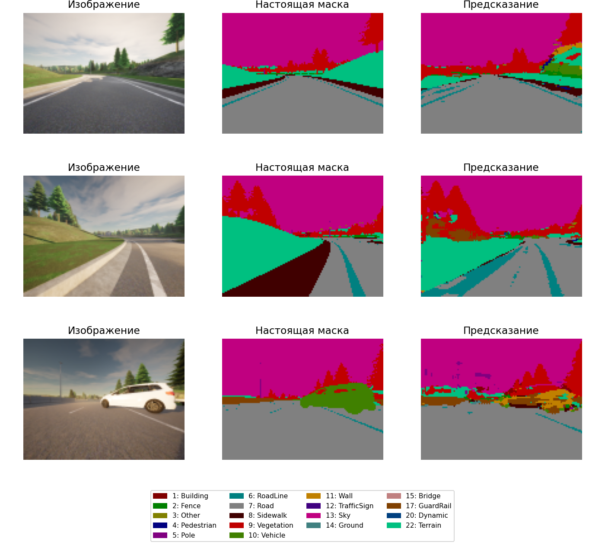
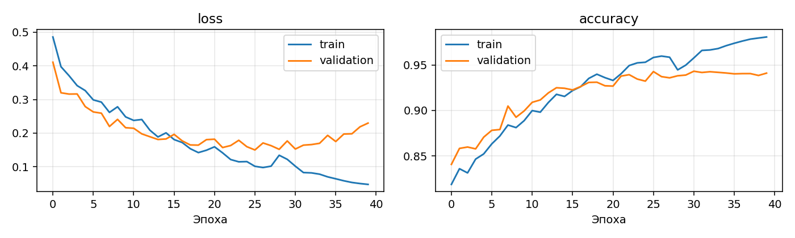
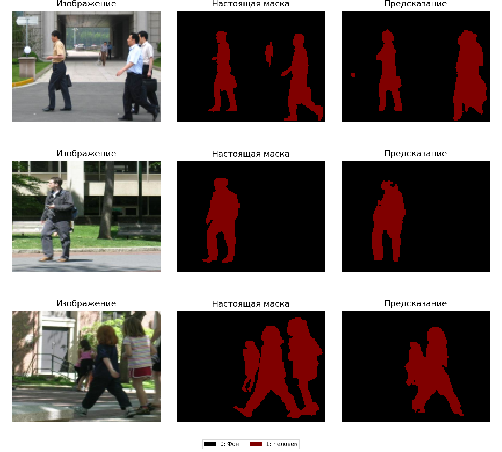
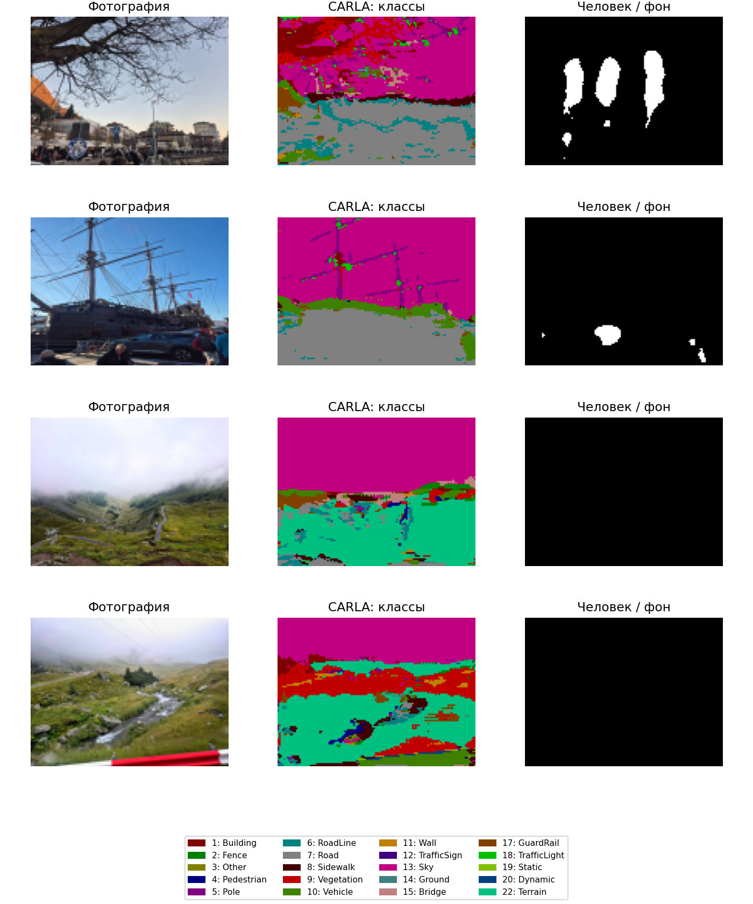

# Лабораторная работа № 2
## Сегментация изображений с помощью U-Net

### Цель работы

Построить модель U-Net, обучить её для сегментации изображений и проверить работу на двух наборах данных.

### 1. Данные

Для первой части использован [набор CARLA](https://github.com/Rhythm-Adhikari1/U-Net/tree/072afa362ab567ceb8c151b18b00e05ac632bf26/data). Он содержит 1060 изображений дорожных сцен и соответствующих масок с 23 классами. На обучение отведено 848 изображений, на валидацию и тест — по 106. Близкие по номеру кадры объединены в группы перед разбиением.

Для второй части выбран [набор Penn-Fudan](https://github.com/swallan/PennFudanPed/tree/ec1d4583fb436b14e2062587c8b28a5018668a5e), содержащий фотографии людей с готовыми масками. В нём 170 изображений: 136 для обучения, 17 для валидации и 17 для тестирования. Все номера людей в исходных масках объединены в один класс: 0 — фон, 1 — человек. Разбиение выполнено случайно с seed=42.

Изображения и маски организованы в папках `images/train`, `images/val`, `images/test` и `masks/train`, `masks/val`, `masks/test`. Каждому изображению соответствует маска с тем же именем.

### 2. Предобработка

С помощью OpenCV изображения приведены к размеру 96×128, переведены в RGB и нормализованы в диапазон [0, 1]. Маски изменены до такого же размера методом nearest neighbor, чтобы сохранить номера классов. Для масок CARLA номер класса считывается из красного канала.

### 3. Модель U-Net

Сеть содержит пять блоков сжатия и четыре блока восстановления. Между соответствующими уровнями используются skip connections. Начальное число фильтров — 32; в двух последних блоках сжатия используется Dropout 0,3. На выходе модель имеет 23 канала для CARLA и 2 канала для Penn-Fudan.

Использованы оптимизатор Adam и sparse categorical crossentropy по logits. Обучение модели CARLA проводилось 40 эпох, модели Penn-Fudan — 40 эпох; размер пакета — 8. Для CARLA функция потерь взвешена по частотам классов в обучающих масках; сохранена модель с лучшим validation mean IoU на эпохе 23. Для Penn-Fudan сохранена модель с минимальным validation loss на эпохе 26.

### 4. Результаты CARLA

На 106 тестовых изображениях получены pixel accuracy **0.886** и mean IoU **0.247**. Крупные области, такие как дорога и небо, определяются лучше небольших объектов. На изображениях ниже показаны исходные кадры, настоящие и предсказанные маски.

### 5. Результаты Penn-Fudan

Для оценки использовано 17 тестовых изображений. Pixel accuracy составила **0.930**, mean IoU по двум классам — **0.776**, IoU класса «человек» — **0.632**.

Модель выделяет основные фигуры, но ошибается на границах и может объединять людей, находящихся рядом. Оценка получена на небольшой тестовой выборке.

### 6. Вывод

В работе построена U-Net и выполнена сегментация двух наборов изображений. Для CARLA сеть определяет 23 класса, для Penn-Fudan — человека и фон. На примерах видны как выделенные области, так и ошибки модели.

### Собственные фотографии

Обученные модели также применены к собственным фотографиям. На последнем столбце белым показана область, которую модель отнесла к человеку. Эталонных масок для этих снимков нет, поэтому метрики для них не рассчитывались. На некоторых фотографиях части фона выделены ошибочно.

