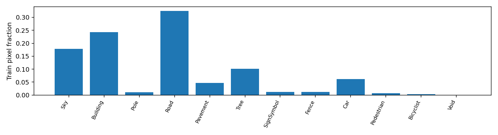
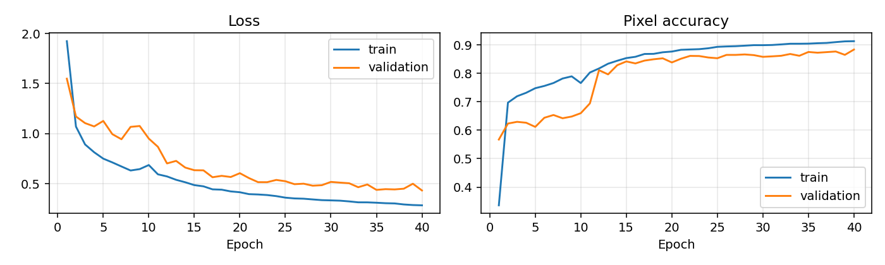
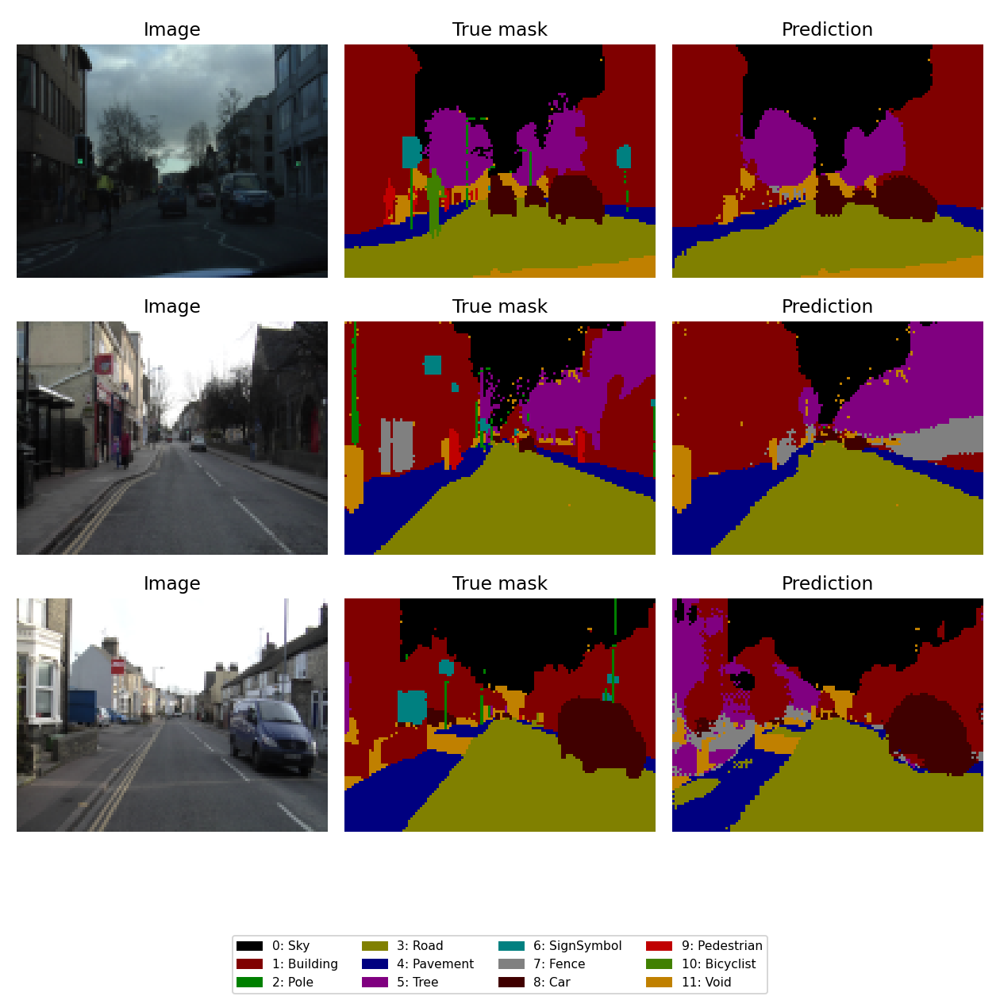
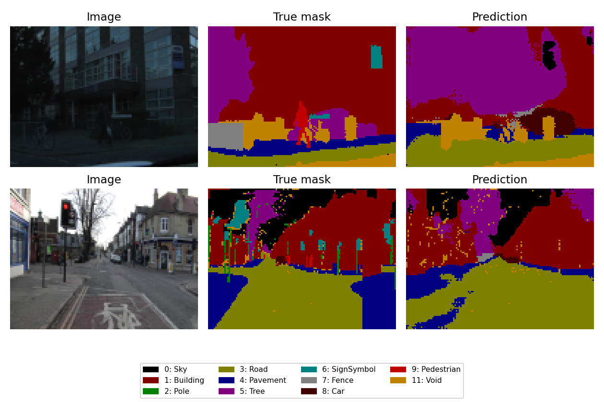
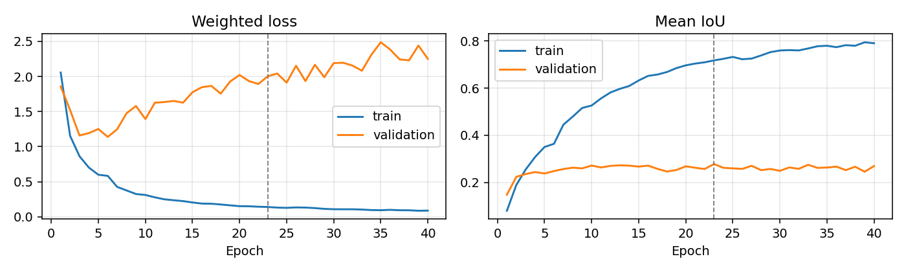
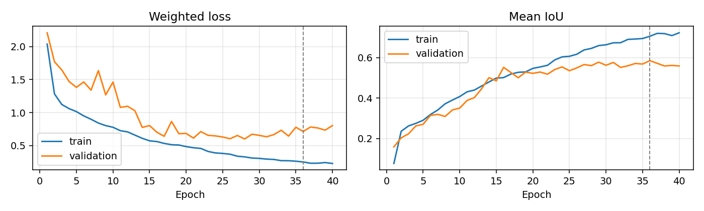
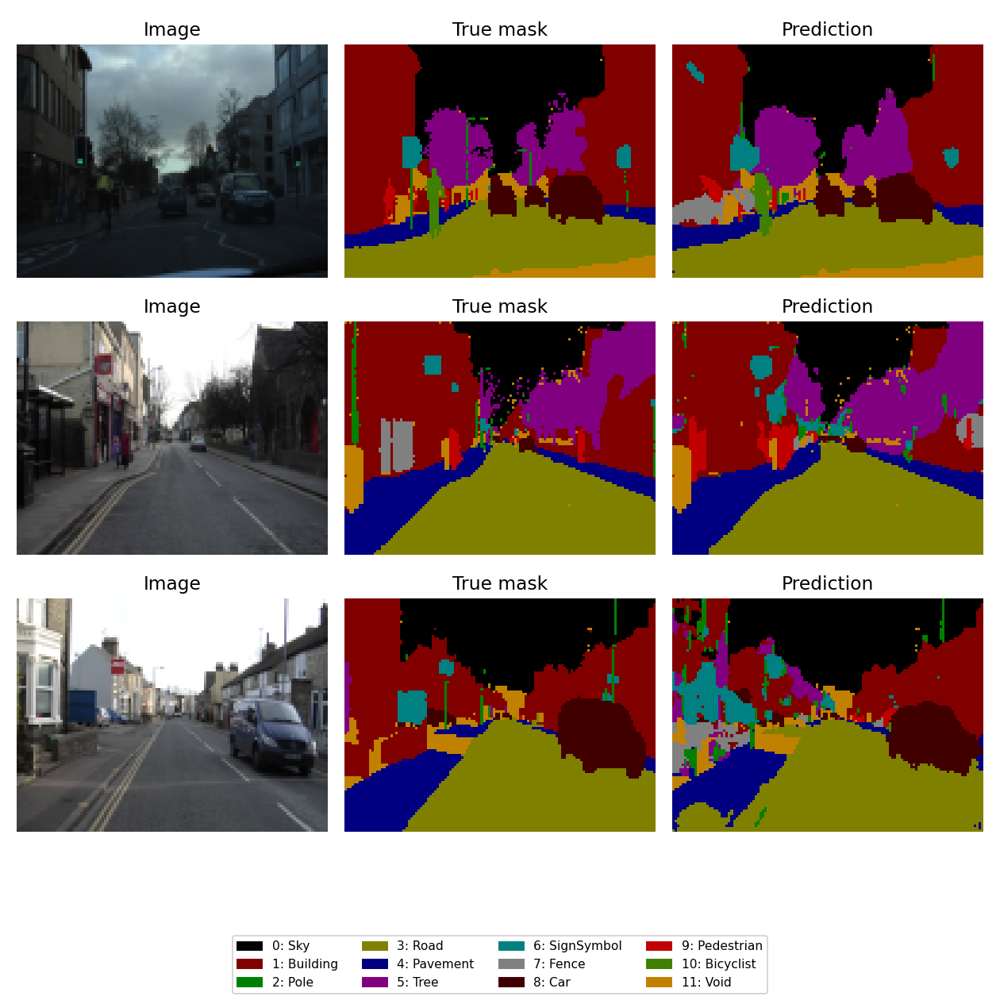
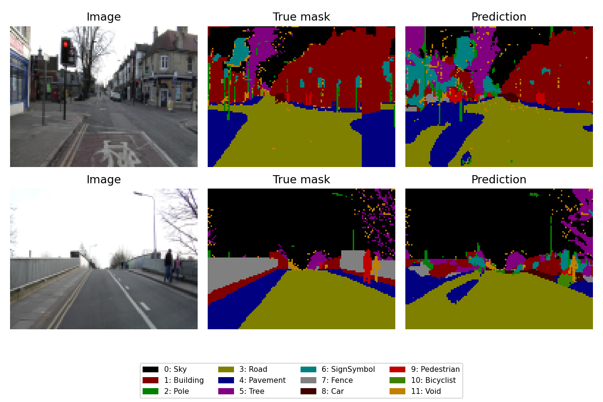
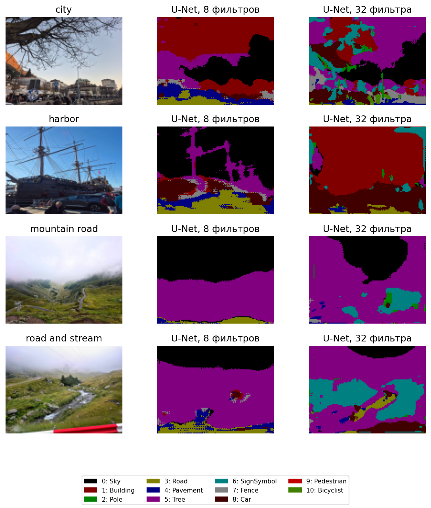

# Лабораторная работа № 2

## Цель и метод

Построить U-Net для сегментации изображений и повторить обучение на двух наборах: учебном CARLA и реальном CamVid. Encoder содержит пять блоков, decoder — четыре. Между ними есть skip connections. Использованы Adam и sparse categorical crossentropy по logits, batch size 8 и 40 эпох. Вход — 96×128×3. Сначала рассмотрена модель с 8 начальными фильтрами, затем — модель с 32 фильтрами и взвешенной функцией потерь.

## Данные

CARLA: 1060 изображений и соответствующих масок для 23 классов. [Источник набора данных](https://github.com/Rhythm-Adhikari1/U-Net/tree/072afa362ab567ceb8c151b18b00e05ac632bf26/data). Разбиение 848/106/106 выполнено целыми группами близких номеров кадров. CamVid: 701 реальное изображение, 11 смысловых классов и Void, сохранено опубликованное разбиение 367/101/233. Маски приведены к размеру входа через nearest neighbor. В CARLA ID читается из красного канала, в CamVid Void исключён из loss и оценки. Источники и версии указаны в README; контрольные суммы — в results/data_manifest.json.

## Итоговые результаты

Лучшая модель выбрана по validation loss. Baseline предсказывает только самый частый класс train. Тест не использовался для выбора эпохи.

| Набор | Тестовых кадров | Accuracy | Baseline accuracy | Mean IoU | Baseline mIoU | Лучшая эпоха |
| --- | ---: | ---: | ---: | ---: | ---: | ---: |
| CARLA | 106 | 0.8832 | 0.3731 | 0.2599 | 0.0207 | 18 |
| CAMVID | 233 | 0.7861 | 0.2639 | 0.3539 | 0.0240 | 40 |

## CARLA

Обучение выполнено на всех 848 обучающих кадрах, 40 эпох. У модели 540,999 параметров. На выбранной эпохе train loss = 0.1686, validation loss = 0.4810. На последней эпохе train loss = 0.1119, validation loss = 0.6053. К концу обучения validation loss ухудшилась при меньшей train loss — это признак переобучения. Для теста использована более ранняя эпоха. Baseline использует класс Road. Превышение baseline: 51.01 процентного пункта accuracy и 0.2392 mean IoU.

| Класс | Оцениваемых пикселей | IoU |
| --- | ---: | ---: |
| Unlabeled | 0 | не оценивается |
| Building | 30785 | 0.5013 |
| Fence | 6594 | 0.0027 |
| Other | 454 | 0.0000 |
| Pedestrian | 177 | 0.0000 |
| Pole | 1841 | 0.0005 |
| RoadLine | 33749 | 0.3543 |
| Road | 485937 | 0.9099 |
| Sidewalk | 49979 | 0.4091 |
| Vegetation | 121194 | 0.6758 |
| Vehicle | 12947 | 0.0763 |
| Wall | 4 | 0.0000 |
| TrafficSign | 199 | 0.0000 |
| Sky | 450261 | 0.9682 |
| Ground | 0 | 0.0000 |
| Bridge | 385 | 0.0000 |
| RailTrack | 0 | не оценивается |
| GuardRail | 7328 | 0.4426 |
| TrafficLight | 0 | не оценивается |
| Static | 7067 | 0.0003 |
| Dynamic | 2680 | 0.0000 |
| Water | 0 | не оценивается |
| Terrain | 90947 | 0.5966 |

Самые частые ошибки по числу пикселей:

- Terrain → Vegetation: 13998 пикселей.
- RoadLine → Road: 13956 пикселей.
- Road → Sidewalk: 10483 пикселей.
- Vegetation → Building: 10204 пикселей.
- Sidewalk → Road: 10012 пикселей.

Наименьшие IoU среди присутствующих классов: Bridge (0.000), Dynamic (0.000), Other (0.000). Общая accuracy скрывает часть этих ошибок из-за дисбаланса числа пикселей. Худшие кадры выбраны по IoU изображения, без повторения ближайших соседей одной серии; при их просмотре нужно обращать внимание на исчезающие тонкие детали и слияние областей разных классов.

У классов Other, Pedestrian, Wall, TrafficSign, Bridge, Dynamic IoU равен нулю при наличии тестовых пикселей. Их распознавание в этом эксперименте не получилось, несмотря на общую accuracy.

## CAMVID

Обучение выполнено на всех 367 обучающих кадрах, 40 эпох. У модели 540,900 параметров. На выбранной эпохе train loss = 0.2838, validation loss = 0.4322. На последней эпохе train loss = 0.2838, validation loss = 0.4322. В этом запуске минимальная validation loss достигнута на последней эпохе. Baseline использует класс Road. Превышение baseline: 52.23 процентного пункта accuracy и 0.3299 mean IoU.

| Класс | Оцениваемых пикселей | IoU |
| --- | ---: | ---: |
| Sky | 497502 | 0.8749 |
| Building | 706359 | 0.6220 |
| Pole | 34018 | 0.0000 |
| Road | 727145 | 0.8358 |
| Pavement | 265356 | 0.5001 |
| Tree | 325017 | 0.4484 |
| SignSymbol | 29146 | 0.0000 |
| Fence | 34194 | 0.0580 |
| Car | 113145 | 0.5534 |
| Pedestrian | 18335 | 0.0000 |
| Bicyclist | 5422 | 0.0000 |
| Void | 0 | не оценивается |

Самые частые ошибки по числу пикселей:

- Building → Tree: 96354 пикселей.
- Pavement → Road: 95890 пикселей.
- Tree → Building: 80922 пикселей.
- Sky → Tree: 25280 пикселей.
- Road → Pavement: 22856 пикселей.

Наименьшие IoU среди присутствующих классов: Bicyclist (0.000), Pedestrian (0.000), Pole (0.000). Общая accuracy скрывает часть этих ошибок из-за дисбаланса числа пикселей. Худшие кадры выбраны по IoU изображения, без повторения ближайших соседей одной серии; при их просмотре нужно обращать внимание на исчезающие тонкие детали и слияние областей разных классов.

У классов Pole, SignSymbol, Pedestrian, Bicyclist IoU равен нулю при наличии тестовых пикселей. Их распознавание в этом эксперименте не получилось, несмотря на общую accuracy.

## Проверки и ограничения

Проверены размеры выходов сети, предобработка изображений и масок, расчёт IoU и сохранение модели. Также проверено отсутствие одинаковых изображений между частями данных и разделение близких кадров CARLA.

Результаты получены при одном seed=42. Группировка CARLA по ID уменьшает утечку соседних кадров, но не гарантирует независимость поездок без метаданных. CamVid использует стандартный тест, однако сцены внутри наборов могут иметь сходные условия. Низкое разрешение и малая ширина сети ограничивают качество мелких классов. Прямое сравнение чисел CARLA и CamVid некорректно: различаются классы, источники и разбиения.

## Вывод

Реализован и выполнен полный процесс сегментации: подготовка двух наборов, построение U-Net, обучение, выбор модели по валидации и независимая тестовая оценка. Поклассовый IoU и сравнение с baseline позволяют увидеть ограничения, которые не показывает одна accuracy. Для дальнейшей проверки нужны новые тестовые кадры и повторения с другими seed.

## 7. Дополнительный эксперимент с полной шириной U-Net

В дополнительном эксперименте использована полная ширина сети из условия: 32, 64, 128, 256 и 512 фильтров в encoder. Обе модели обучены заново, по 40 эпох. Для уменьшения влияния дисбаланса классов веса функции потерь рассчитаны только по train: w_c пропорционален 1 / sqrt(max(f_c, 0.002)), где f_c — доля пикселей класса; затем веса нормированы так, чтобы средний вес обучающего пикселя был равен единице. У отсутствующих в train классов вес равен нулю. Void CamVid исключён из обучения и оценки. Контрольная точка выбрана по максимальному mean IoU на validation; тест для этого не использован.

| Набор | Validation IoU, 8 фильтров | Validation IoU, 32 фильтра | Test IoU, 8 фильтров | Test IoU, 32 фильтра | Выбор по validation |
| --- | ---: | ---: | ---: | ---: | ---: |
| CARLA | 0.222 | 0.278 | 0.260 | 0.247 | 32 |
| CAMVID | 0.468 | 0.585 | 0.354 | 0.446 | 32 |

В стандартном mIoU класс с нулевым объединением исключается, а отсутствующий в разметке, но ошибочно предсказанный класс получает IoU=0. Поэтому число усредняемых классов у моделей может различаться. Дополнительно привожу среднее только по классам, присутствующим в тестовой разметке. Ошибочные предсказания отсутствующих классов при этом снижают IoU истинных классов.

| Набор | Классов в разметке | mIoU: 8 фильтров | mIoU: 32 фильтра |
| --- | ---: | ---: | ---: |
| CARLA | 18 | 0.274 | 0.302 |
| CAMVID | 11 | 0.354 | 0.446 |

Обе версии используют одинаковые данные, разрешение и разбиения. Одновременно изменились ширина сети и функция потерь, поэтому определить отдельный вклад каждого изменения нельзя. Их loss нельзя сравнивать напрямую. Модель с 8 фильтрами выбрана по минимальному validation loss, модель с 32 — по максимальному validation IoU; схемы выбора эпох различаются. Тестовые результаты модели с 8 фильтрами анализировались при выборе следующего эксперимента, поэтому сравнение носит исследовательский характер. Дополнительная проверка на новых кадрах описана в разделе 8.

### CARLA: полная сеть

Лучшая эпоха по validation IoU: 23. Accuracy на тесте: 0.886; mean IoU: 0.247.

| Класс | IoU: 8 фильтров | IoU: 32 фильтра |
| --- | ---: | ---: |
| Unlabeled | — | — |
| Building | 0.501 | 0.484 |
| Fence | 0.003 | 0.202 |
| Other | 0.000 | 0.007 |
| Pedestrian | 0.000 | 0.002 |
| Pole | 0.001 | 0.044 |
| RoadLine | 0.354 | 0.451 |
| Road | 0.910 | 0.920 |
| Sidewalk | 0.409 | 0.454 |
| Vegetation | 0.676 | 0.722 |
| Vehicle | 0.076 | 0.247 |
| Wall | 0.000 | 0.000 |
| TrafficSign | 0.000 | 0.000 |
| Sky | 0.968 | 0.963 |
| Ground | 0.000 | 0.000 |
| Bridge | 0.000 | 0.000 |
| RailTrack | — | 0.000 |
| GuardRail | 0.443 | 0.380 |
| TrafficLight | — | 0.000 |
| Static | 0.000 | 0.002 |
| Dynamic | 0.000 | 0.004 |
| Water | — | 0.000 |
| Terrain | 0.597 | 0.559 |

Наибольший рост IoU: Fence (+0.200), Vehicle (+0.171), RoadLine (+0.097).

Наибольшее снижение IoU: GuardRail (-0.063), Terrain (-0.038), Building (-0.018).

Самые частые ошибки по числу пикселей:

- Terrain → Vegetation: 18099.
- Sidewalk → Road: 11676.
- RoadLine → Road: 10908.

Ошибочные предсказания классов, отсутствующих среди оцениваемых тестовых пикселей: Ground (2290 пикселей), TrafficLight (100 пикселей), RailTrack (21 пикселей), Water (2 пикселей).

Классы с нулевым IoU в этой оценке: Wall, TrafficSign, Ground, Bridge, RailTrack, TrafficLight, Water. Их качество требует дальнейшей работы.

### CAMVID: полная сеть

Лучшая эпоха по validation IoU: 36. Accuracy на тесте: 0.789; mean IoU: 0.446.

| Класс | IoU: 8 фильтров | IoU: 32 фильтра |
| --- | ---: | ---: |
| Sky | 0.875 | 0.887 |
| Building | 0.622 | 0.574 |
| Pole | 0.000 | 0.103 |
| Road | 0.836 | 0.867 |
| Pavement | 0.500 | 0.612 |
| Tree | 0.448 | 0.527 |
| SignSymbol | 0.000 | 0.140 |
| Fence | 0.058 | 0.103 |
| Car | 0.553 | 0.649 |
| Pedestrian | 0.000 | 0.246 |
| Bicyclist | 0.000 | 0.201 |
| Void | — | — |

Наибольший рост IoU: Pedestrian (+0.246), Bicyclist (+0.201), SignSymbol (+0.140).

Наибольшее снижение IoU: Building (-0.048).

Самые частые ошибки по числу пикселей:

- Building → Tree: 85247.
- Building → SignSymbol: 61126.
- Pavement → Road: 59371.

## 8. Проверка на другом наборе CARLA

Для независимой проверки взяты 223 контрольных кадра из [отдельного набора CARLA 0.9.5](https://github.com/cpow-89/carla_image_segmentation_dataset/tree/aa0eb00150f3fda6f7950f097baa145890717979). Они не использовались при обучении, выборе весов или параметров. Совпадений файлов с предыдущими наборами по SHA-256 нет. Метка 0 означает Unlabeled и исключена; IoU усредняется по поддерживаемым классам 1–12, присутствующим в разметке: один и тот же набор классов используется для всех моделей. Предсказание других классов на размеченных пикселях считается ошибкой. Код 10 называется Car в этом наборе и Vehicle в учебном. Сравнивать это значение напрямую с mIoU по 23 классам нельзя. На иллюстрациях неразмеченные области замаскированы и в предсказаниях. Оценено 1808785 из 2740224 пикселей после resize (66.0%); остальные имеют метку Unlabeled.

| Модель | Pixel accuracy | Mean IoU по классам 1–12 |
| --- | ---: | ---: |
| Baseline: Road | 0.503 | 0.046 |
| U-Net, 8 фильтров | 0.480 | 0.146 |
| U-Net, 32 фильтра | 0.656 | 0.247 |

По прежней validation-части выбрана модель с 32 начальными фильтрами. Контрольные кадры получены отдельно, но разные наборы используют симулятор CARLA и могут содержать общие виртуальные сцены. Кадры внутри одного run также могут быть похожи между собой, поэтому 223 кадра не равнозначны 223 независимым сценам.

| Класс | Пиксели | IoU: 8 фильтров | IoU: 32 фильтра |
| --- | ---: | ---: | ---: |
| Building | 286498 | 0.371 | 0.529 |
| Fence | 1284 | 0.002 | 0.002 |
| Other | 5047 | 0.000 | 0.006 |
| Pedestrian | 0 | — | — |
| Pole | 69207 | 0.001 | 0.034 |
| RoadLine | 55009 | 0.103 | 0.268 |
| Road | 909174 | 0.547 | 0.748 |
| Sidewalk | 103666 | 0.164 | 0.238 |
| Vegetation | 71712 | 0.325 | 0.526 |
| Vehicle | 180102 | 0.008 | 0.357 |
| Wall | 125222 | 0.089 | 0.004 |
| TrafficSign | 1864 | 0.000 | 0.000 |

В этой контрольной части нет размеченных пешеходов, поэтому recall класса Pedestrian по ней определить нельзя. На остальных размеченных пикселях модель с 8 фильтрами ошибочно предсказала Pedestrian 0 раз, с 32 фильтрами — 20054 раз.

### Вывод по дополнительному эксперименту

- Для CARLA по validation выбрана модель с 32 фильтрами (mIoU 0.278).
- Для CAMVID по validation выбрана модель с 32 фильтрами (mIoU 0.585).

На отдельных кадрах CARLA выбранная дорожная модель получила mIoU 0.247 по классам 1–12; baseline получил 0.046. Результат описывает только оцениваемые классы и условия этого набора. Для устойчивых выводов нужны другие сцены и повторения обучения с разными seed.

## 9. Проверка на собственных фотографиях

Для дополнительной визуальной проверки использованы четыре собственные фотографии: город, набережная и два горных дорожных вида. Каждый снимок приведён к 96×128 и обработан уже обученными моделями с 8 и 32 фильтрами. Цвета показывают предсказанные классы; разметки этих фотографий нет, поэтому accuracy и IoU для них не вычислялись.

На городских снимках обе модели выделяют отдельные крупные области, но ошибаются на мелких объектах и границах. Горные сцены отличаются от дорожных кадров обучения: местность и другие детали нередко получают неподходящие дорожные классы. Это качественная проверка переноса, а приведённые выше численные метрики относятся к размеченным тестовым наборам.
